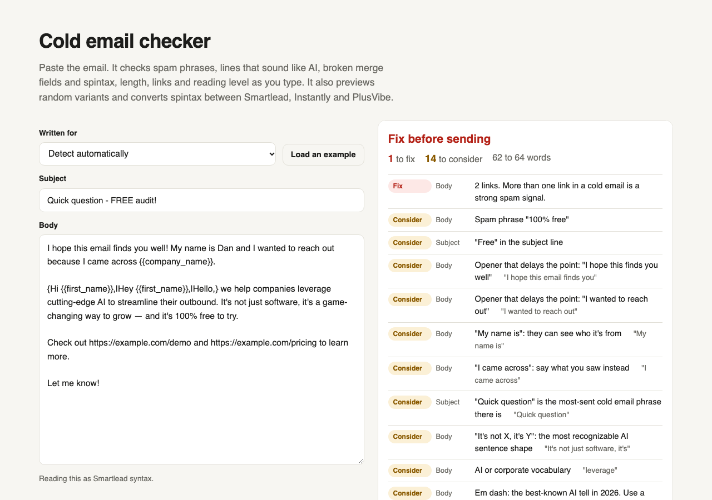

# Cold email checker

Paste a cold email and get a report as you type. It checks:

- spam phrases
- lines that sound like AI wrote them
- broken merge fields and spintax
- length, links and reading grade

It also previews random variants with sample data and converts spintax between Smartlead, Instantly and PlusVibe.

**Use it in the browser:** https://trav54219.github.io/cold-email-checker/ (nothing you paste leaves your browser)

## What it checks

| | Fails | Warns |
|---|---|---|
| Syntax | an unclosed `{{` or `{`, a stray brace, spintax with one option, single braces in Instantly or PlusVibe copy, an empty `{{}}`, a `[First Name]` placeholder left in | |
| Deliverability | more than one link, an image, a spam phrase in the subject, `Re:` or `Fwd:` on a first email | one link, a spam phrase in the body, "free" in the subject, an attachment mentioned, no spintax, no merge fields |
| Voice | | "I hope this finds you well", "I wanted to reach out", "My name is", "Quick question", "It's not X, it's Y", "Here's the thing", em dashes, corporate words, more "I/we" than "you" |
| Shape | over 150 words in any variant | over 110 words, no question, a paragraph over 60 words, reading grade above 9, exclamation marks, shouting |

Word counts cover every spintax variant, so a short version doesn't hide a long one. Phrase checks read inside every spintax option too.

## Spintax conversion

| | Spintax | Variable with fallback |
|---|---|---|
| Smartlead | `{Hi\|Hey}` | `{{first_name\|there}}` |
| Instantly | `{{RANDOM \| Hi \| Hey}}` | `{{firstName \| there}}` |
| PlusVibe | `{{random\|Hi\|Hey}}` | `{{fallback\|{{first_name}}\|there}}` |

Variable names (`company_name` and `companyName`), custom fields (`{{title}}` and `{{custom_title}}`), and sender tags (`%signature%` and `{{sender_signature}}`) are mapped. A round trip through all three returns the original text, and a test checks that. Anything that can't carry over is listed instead of dropped. Examples: PlusVibe allows only one variable per spin option, and Instantly has no signature tag I could confirm.

The Instantly syntax comes from [Instantly's spintax help article](https://help.instantly.ai/en/articles/6384663-how-to-use-spintax). The PlusVibe syntax comes from its help center and the translator I wrote for my own client portal.

## How I tested it

`node --test` runs 11 tests: conversions, broken syntax, a clean email that must pass, and a spammy one that must fail on each rule. Then I ran it on 8 email variants from 5 of my own live campaigns, which had already been through my internal copy gate. The only false flag was "WCAG" counted as shouting, so acronyms are now allowed, and only long all-caps words or two in a row count as shouting.

The spam phrase list is short on purpose. Single words like "free" or "sales" are judged in context, because a list that bans every common word just teaches people to ignore it.

Built by [Travis Heurtelou](https://trav54219.github.io/gtm-engineering-portfolio/). Also: [Domain health](https://trav54219.github.io/domain-health/), [Lead name cleaner](https://trav54219.github.io/lead-name-cleaner/). MIT license.
